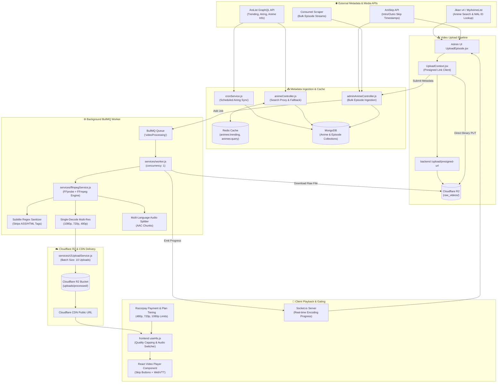
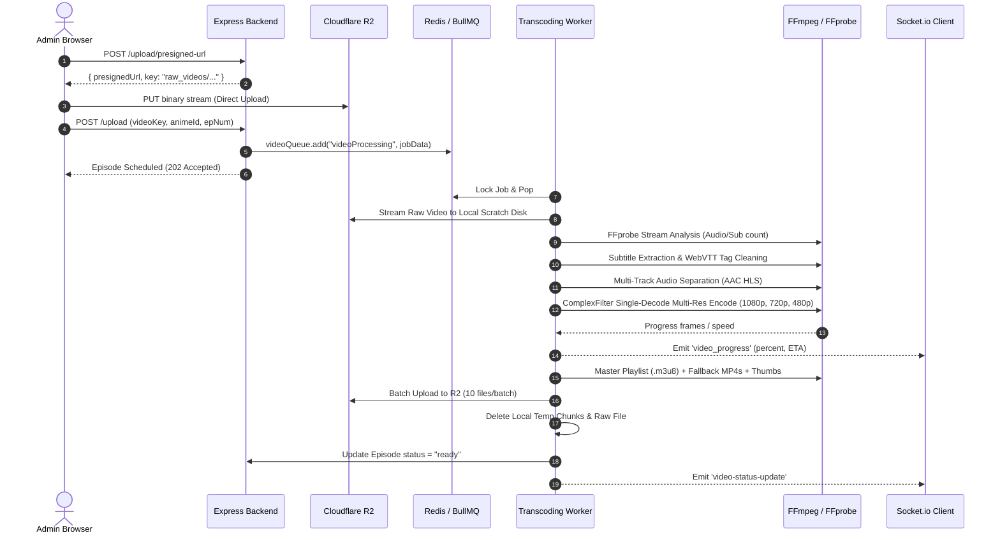

# 🎬 AnimeStream: Comprehensive HLS Video Pipeline & External Metadata Architecture

> **Document Version:** 1.0.0  
> **Repository:** `manavsharma111/anime-streaming-website`  
> **Scope:** External Anime Metadata Ingestion, FFmpeg HLS Transcoding, Cloudflare R2 CDN Pipeline, BullMQ Queue Workers, Monetization Tier Gating, and Hls.js Frontend Playback.

---

## 📌 Executive Summary

This document explains the **end-to-end media and metadata pipeline** of the AnimeStream platform.

### Quick Answer to Key Questions:
1. **Are the code snippets provided the core parts of HLS?**  
   **Yes!** The provided files (`ffmpegService.js`, `r2UploadService.js`, BullMQ workers, `UploadContext.jsx`, and `useHls.js`) represent the **transcoding, storage, queue management, and client-side playback backbone** of the platform.
2. **Does that code include the external API metadata fetching logic?**  
   **No.** In the provided snippets, the external metadata fetching logic is missing. That logic lives in other specific modules in the project:
   - [`cronService.js`](file:///c:/NEWTUBE/backend/services/cronService.js) & [`animeController.js`](file:///c:/NEWTUBE/backend/controllers/animeController.js) (AniList GraphQL API)
   - [`useJikan.js`](file:///c:/NEWTUBE/frontend/src/hooks/useJikan.js) (Jikan v4 / MyAnimeList API)
   - [`UploadEpisode.jsx`](file:///c:/NEWTUBE/frontend/src/components/AdminDashBoard/UploadEpisode.jsx) & [`adminAnimeController.js`](file:///c:/NEWTUBE/backend/controllers/adminAnimeController.js) (AniSkip API for Intro/Outro skip times)
   - [`adminAnimeController.js`](file:///c:/NEWTUBE/backend/controllers/adminAnimeController.js) (Consumet Scraper for bulk episodes)

Below is the complete architectural guide, including all external API code, data structures, and the end-to-end execution flow.

---

## 🏗️ High-Level System Architecture Diagram



---

## 🌐 1. External Metadata Ingestion: Exact Code & Workflow

The platform leverages **four separate external services** to maintain fresh anime data, high-resolution banners, and skip timestamps.

### 1.1 AniList GraphQL API (`https://graphql.anilist.co`)

#### Purpose:
- Automated catalog population for currently airing anime.
- Real-time proxy fallback when users search for anime not yet cached in MongoDB.
- Fetching cover images, banners, trailer links, genres, and ratings.

#### Code Location: [`cronService.js`](file:///c:/NEWTUBE/backend/services/cronService.js)
```javascript
const cron = require("node-cron")
const axios = require("axios")
const Anime = require("../models/Anime")

// Helper to map AniList format to the local MongoDB schema
const mapAnilistToAnime = (alAnime) => {
  return {
    title: alAnime.title?.english || alAnime.title?.romaji || "Unknown Title",
    description: (alAnime.description || "No description available.").replace(/<br>/g, "\n"),
    year: alAnime.seasonYear || new Date().getFullYear(),
    rating: (alAnime.averageScore || 0) / 10,
    thumbnail: alAnime.coverImage?.extraLarge || alAnime.coverImage?.large || "",
    cover: alAnime.bannerImage || alAnime.coverImage?.extraLarge || "",
    trailerUrl: alAnime.trailer?.site === "youtube"
      ? `https://www.youtube.com/watch?v=${alAnime.trailer.id}`
      : "",
    genres: alAnime.genres || ["Unknown"],
    status: alAnime.status === "RELEASING" ? "ongoing" : "completed",
    totalEpisodes: alAnime.episodes || null,
  }
}

// Cron: Runs every 24 hours to sync top airing anime
const syncLatestAnime = async () => {
  const query = `
    query {
      Page(page: 1, perPage: 20) {
        media(type: ANIME, status: RELEASING, sort: SCORE_DESC) {
          idMal title { english romaji } description seasonYear averageScore 
          coverImage { extraLarge large } bannerImage trailer { id site } genres episodes status
        }
      }
    }
  `
  const response = await axios.post("https://graphql.anilist.co", { query })
  const animes = response.data.data.Page.media

  for (const alAnime of animes) {
    const mappedAnime = mapAnilistToAnime(alAnime)
    const existing = await Anime.findOne({ title: mappedAnime.title })
    if (!existing) {
      await new Anime(mappedAnime).save()
    }
  }
}
```

#### Code Location: [`animeController.js`](file:///c:/NEWTUBE/backend/controllers/animeController.js) (Search Proxy & Fallback)
```javascript
// When user searches for an anime not in local DB:
if (search && pageNumber === 1) {
  const queryStr = `
    query($search: String) {
      Page(page: 1, perPage: 5) {
        media(type: ANIME, search: $search) {
          id idMal title { english romaji } description seasonYear averageScore 
          coverImage { extraLarge large } bannerImage trailer { id site } genres episodes status
        }
      }
    }
  `
  const alRes = await axios.post("https://graphql.anilist.co", {
    query: queryStr,
    variables: { search },
  })
  // Merged with local MongoDB results without duplicating
}
```

---

### 1.2 Jikan (MyAnimeList) API v4 (`https://api.jikan.moe/v4`)

#### Purpose:
- Providing real-time top airing anime for the landing page without requiring authentication.
- Resolving MyAnimeList ID (`mal_id`) by searching for the anime title, which is required for the AniSkip API.

#### Code Location: [`useJikan.js`](file:///c:/NEWTUBE/frontend/src/hooks/useJikan.js)
```javascript
export function useJikanAnime() {
  const [data, setData] = useState({ topAiring: [], loading: true })

  useEffect(() => {
    let mounted = true
    const fetchData = async () => {
      try {
        const res = await fetch("https://api.jikan.moe/v4/top/anime?filter=airing&limit=15")
        const json = await res.json()
        if (mounted && json.data) {
          setData({ topAiring: json.data, loading: false })
        }
      } catch (error) {
        if (mounted) setData({ topAiring: [], loading: false })
      }
    }
    const timer = setTimeout(fetchData, 300)
    return () => { mounted = false; clearTimeout(timer) }
  }, [])

  return data
}
```

---

### 1.3 AniSkip API (`https://api.aniskip.com/v2/skip-times`)

#### Purpose:
- Fetches millisecond-precise timestamps for Opening (`op`) and Ending (`ed`) sequences.
- Enables the video player to display interactive **"Skip Intro"** and **"Skip Outro"** buttons.

#### Code Location: [`UploadEpisode.jsx`](file:///c:/NEWTUBE/frontend/src/components/AdminDashBoard/UploadEpisode.jsx) & [`adminAnimeController.js`](file:///c:/NEWTUBE/backend/controllers/adminAnimeController.js)
```javascript
// Step 1: Obtain MAL ID via title search (using Jikan or AniList)
const jikanRes = await axios.get(
  `https://api.jikan.moe/v4/anime?q=${encodeURIComponent(selectedAnime.title)}&limit=1`
)
const malId = jikanRes.data.data[0].mal_id

// Step 2: Query AniSkip using malId and episodeNumber
const aniskipRes = await axios.get(
  `https://api.aniskip.com/v2/skip-times/${malId}/${episodeNumber}?types[]=op&types[]=ed&episodeLength=0`
)

if (aniskipRes.data.found) {
  const op = aniskipRes.data.results.find((r) => r.skipType === "op")
  const ed = aniskipRes.data.results.find((r) => r.skipType === "ed")

  const introStart = op ? Math.round(op.interval.startTime) : 0
  const introEnd   = op ? Math.round(op.interval.endTime) : 0
  const outroStart = ed ? Math.round(ed.interval.startTime) : 0
  const outroEnd   = ed ? Math.round(ed.interval.endTime) : 0
}
```

---

### 1.4 Consumet Scraper (`@consumet/extensions`)

#### Purpose:
- Automated bulk episode fetching: Extracts episode lists and direct HLS stream manifests directly from third-party anime providers without manual video uploading.

#### Code Location: [`adminAnimeController.js`](file:///c:/NEWTUBE/backend/controllers/adminAnimeController.js#L430-L540)
```javascript
const { META } = require("@consumet/extensions")
const anilist = new META.Anilist()

// 1. Search anime
const searchRes = await anilist.search(title)
const consumetId = searchRes.results[0].id

// 2. Fetch all episodes
const infoRes = await anilist.fetchAnimeInfo(consumetId)
for (const ep of infoRes.episodes) {
  // 3. Fetch native stream sources
  const watchRes = await anilist.fetchEpisodeSources(ep.id)
  const bestSource = watchRes.sources.find((s) => s.quality === "auto") || watchRes.sources[0]

  // 4. Save episode directly with "ready" status
  await new Episode({
    anime: animeId,
    episodeNumber: ep.number,
    title: ep.title || `Episode ${ep.number}`,
    videoUrl: bestSource.url,
    status: "ready",
  }).save()
}
```

---

## 🎥 2. End-to-End Video Upload & HLS Transcoding Pipeline



### 2.1 Presigned Direct Upload (`UploadContext.jsx`)
Instead of routing multi-gigabyte video files through the Node.js API server (which causes Out-Of-Memory and CPU spikes), the browser requests a **Presigned S3/R2 URL**:
1. Frontend makes a small JSON request: `POST /upload/presigned-url`.
2. Backend creates an AWS S3 `PutObjectCommand` presigned link with a unique key: `raw_videos/<timestamp>_<filename>`.
3. Frontend streams the video directly to Cloudflare R2 via `axios.put(presignedUrl, videoFile)`.
4. Once completed, only the `videoKey` string is posted to the backend.

### 2.2 Transcoding Worker & Queue (`worker.js` / `videoQueue.js`)
- Runs BullMQ with `concurrency: 1` to strictly ensure that CPU/RAM limits are respected.
- Downloads the raw video from R2 as a local stream to prevent FFmpeg HTTP buffer SIGSEGV crashes.
- Manages lock renewal (`lockDuration: 60000ms`, `lockRenewTime: 15000ms`).

### 2.3 The FFmpeg Transcoding Pipeline (`ffmpegService.js`)

#### A. FFprobe Stream Analysis:
Detects video height, video codecs, all embedded audio streams (Japanese, English, Hindi, etc.), and subtitle codecs (`subrip`, `ass`, `ssa`, `mov_text`).

#### B. Subtitle Extraction & Tag Sanitization:
Anime `.mkv` files frequently contain advanced ASS positioning tags (e.g. `{\an8}`, font tags, color hexes). Web players fail to render these properly.
The pipeline extracts each subtitle stream into `.vtt` and runs regular expression cleanups:
```javascript
content = content.replace(/\{[^}]+\}/g, "")             // Removes {\an8} and ASS placement tags
content = content.replace(/<\/?(?:font|b|i|u|c)[^>]*>/g, "") // Removes HTML formatting
content = content.replace(/\n{3,}/g, "\n\n")            // Normalizes empty vertical gaps
```

#### C. Isolated Multi-Track Audio Packaging:
Extracts internal and uploaded external audio tracks into discrete HLS streams (`audio_0`, `audio_1`) formatted with AAC at 128 kbps. If the audio is already AAC, it uses `-c:a copy` to save processing power.

#### D. Single-Decode Multi-Resolution Video Encoding:
Decoding a 1080p source 3 separate times consumes 300% CPU. AnimeStream uses an FFmpeg `complexFilter` to **decode once** and split the video frame buffer into 3 scaled streams simultaneously:
```javascript
complexFilters.push("[0:v:0]split=3[v1][v2][v3]")
complexFilters.push("[v1]scale=-2:1080,format=yuv420p[v1080out]")
complexFilters.push("[v2]scale=-2:720,format=yuv420p[v720out]")
complexFilters.push("[v3]scale=-2:480,format=yuv420p[v480out]")
```

Key Encoding Flags:
- `-c:v libx264`: Universally compatible H.264 video.
- `-profile:v main`: Decodable by older smart TVs and low-end mobile devices.
- `-pix_fmt yuv420p`: Standard 8-bit color space (prevents green screens from 10-bit anime source files).
- `-g 48 -keyint_min 48 -sc_threshold 0`: Enforces fixed 2-second keyframes (GOP) matching the 6-second segment chunk size (`-hls_time 6`).
- `-threads 1`: Restricts CPU thread hogging.

#### E. Master Playlist Compilation:
Generates `master.m3u8` connecting video variant streams to multi-language audio streams:
```m3u8
#EXTM3U
#EXT-X-MEDIA:TYPE=AUDIO,GROUP-ID="audio",NAME="Japanese",DEFAULT=YES,AUTOSELECT=YES,URI="audio_0/manifest.m3u8"
#EXT-X-MEDIA:TYPE=AUDIO,GROUP-ID="audio",NAME="English",DEFAULT=NO,AUTOSELECT=YES,URI="audio_1/manifest.m3u8"
#EXT-X-STREAM-INF:BANDWIDTH=3000000,RESOLUTION=1920x1080,AUDIO="audio"
0/manifest.m3u8
#EXT-X-STREAM-INF:BANDWIDTH=1500000,RESOLUTION=1280x720,AUDIO="audio"
1/manifest.m3u8
#EXT-X-STREAM-INF:BANDWIDTH=800000,RESOLUTION=854x480,AUDIO="audio"
2/manifest.m3u8
```

#### F. Direct MP4 Repackaging:
Quickly creates direct-download MP4 files using `-c copy -bsf:a aac_adtstoasc` without re-encoding.

#### G. Sprite Sheet Thumbnails:
Generates scrubbing preview frames: `-vf fps=1/60,scale=320:180` (1 thumbnail per 60 seconds of video).

---

## ☁️ 3. Cloudflare R2 Upload & Cleanup (`r2UploadService.js`)

Once transcoding finishes:
1. `getAllFiles()` scans the output directory.
2. Files are uploaded in batches (`BATCH_SIZE = 10`) to prevent socket exhaustion.
3. Media files (`.ts`, `.mp4`) are streamed via `fs.createReadStream()` to prevent Node.js buffer memory crashes.
4. `.m3u8` playlists have Windows backslashes normalized to forward slashes.
5. All local temporary directories and raw video files are unlinked (`fsPromises.rm(outputDir, { recursive: true, force: true })`).
6. Episode URLs in MongoDB are rewritten from local paths to public CDN URLs: `${process.env.CLOUDFLARE_R2_PUBLIC_URL}/uploads/processed/${folderId}/...`.

---

## 💳 4. Monetization & Resolution Gating Architecture

### 4.1 Plan Tiers & Capabilities

| Plan Tier | Price (Monthly / Yearly) | Max Resolution Allowed | Downloads Allowed |
| :--- | :--- | :--- | :--- |
| **Super Saiyan** | ₹99 / ₹999 | **480p** | ❌ No |
| **Super Saiyan Rose** | ₹199 / ₹1999 | **720p** | ✅ Yes |
| **Mastered Ultra Instinct** | ₹299 / ₹2999 | **1080p** | ✅ Yes |

### 4.2 Prorated Upgrade Calculation ([`paymentController.js`](file:///c:/NEWTUBE/backend/controllers/paymentController.js))
When a user switches plans, the system automatically computes the remaining value of their current plan and deducts it from the new plan:
```javascript
const timeDiff = activeSub.endDate.getTime() - new Date().getTime()
const daysRemaining = Math.ceil(timeDiff / (1000 * 3600 * 24))
const oldPricePerDay = oldPlan.price / oldPlan.duration
const remainingValue = Math.floor(oldPricePerDay * daysRemaining)

// Apply discount to the new plan price
finalAmount = Math.max(1, finalAmount - remainingValue)
```

---

## 📺 5. Frontend HLS Playback Engine (`useHls.js`)

The custom React hook [`useHls.js`](file:///c:/NEWTUBE/frontend/src/hooks/useHls.js) wraps `hls.js` and enforces subscription limits:

```javascript
// 1. Filter out video quality levels that exceed the user's plan
const levels = Object.values(uniqueLevels)
  .sort((a, b) => b.height - a.height)
  .filter((level) => level.height <= maxAllowedResolution)
  .map((level) => ({
    id: level.originalIndex, // Original index in master manifest
    name: `${level.height}p`,
  }))

// 2. Prevent auto-level algorithm from ramping up past maxAllowedResolution
let maxAllowedIndex = -1
hls.levels.forEach((l, index) => {
  if (l.height <= maxAllowedResolution) {
    maxAllowedIndex = Math.max(maxAllowedIndex, index)
  }
})
if (maxAllowedIndex !== -1) {
  hls.autoLevelCapping = maxAllowedIndex
}
```

### Key Features:
- **Quality Selector**: Automatically restricts 480p users from choosing 720p or 1080p.
- **Audio Switcher**: Reads discrete `#EXT-X-MEDIA:TYPE=AUDIO` tracks and lets users toggle between Japanese, English, Hindi, etc.
- **Subtitle Switcher**: Manages WebVTT subtitles and stores preferred settings in `localStorage`.
- **Skip Intro/Outro**: Syncs with `introStart`, `introEnd`, `outroStart`, and `outroEnd` stored in MongoDB from AniSkip.

---

## 🗂️ 6. Summary Matrix of Files in the Pipeline

| File Path | Role in Architecture |
| :--- | :--- |
| [`cronService.js`](file:///c:/NEWTUBE/backend/services/cronService.js) | Scheduled auto-sync of airing anime using AniList GraphQL |
| [`animeController.js`](file:///c:/NEWTUBE/backend/controllers/animeController.js) | Public search proxy and trending cache fallback via AniList |
| [`adminAnimeController.js`](file:///c:/NEWTUBE/backend/controllers/adminAnimeController.js) | Consumet bulk scraper, AniSkip skip intervals, episode upload |
| [`UploadEpisode.jsx`](file:///c:/NEWTUBE/frontend/src/components/AdminDashBoard/UploadEpisode.jsx) | Admin episode form, Jikan MAL lookup, AniSkip interval preview |
| [`useJikan.js`](file:///c:/NEWTUBE/frontend/src/hooks/useJikan.js) | Landing page top airing feed from Jikan v4 API |
| [`UploadContext.jsx`](file:///c:/NEWTUBE/frontend/src/context/UploadContext.jsx) | Browser-to-Cloudflare R2 direct presigned upload engine |
| [`worker.js`](file:///c:/NEWTUBE/backend/services/worker.js) | BullMQ video processing consumer & download manager |
| [`ffmpegService.js`](file:///c:/NEWTUBE/backend/services/ffmpegService.js) | Core FFprobe inspection, audio split, VTT sanitizer, multi-res HLS |
| [`r2UploadService.js`](file:///c:/NEWTUBE/backend/services/r2UploadService.js) | Batch uploader to Cloudflare R2 bucket & storage cleaner |
| [`paymentController.js`](file:///c:/NEWTUBE/backend/controllers/paymentController.js) | Razorpay order creation, proration math, and signature validation |
| [`useHls.js`](file:///c:/NEWTUBE/frontend/src/hooks/useHls.js) | Client-side Hls.js hook with resolution caps & track switcher |
